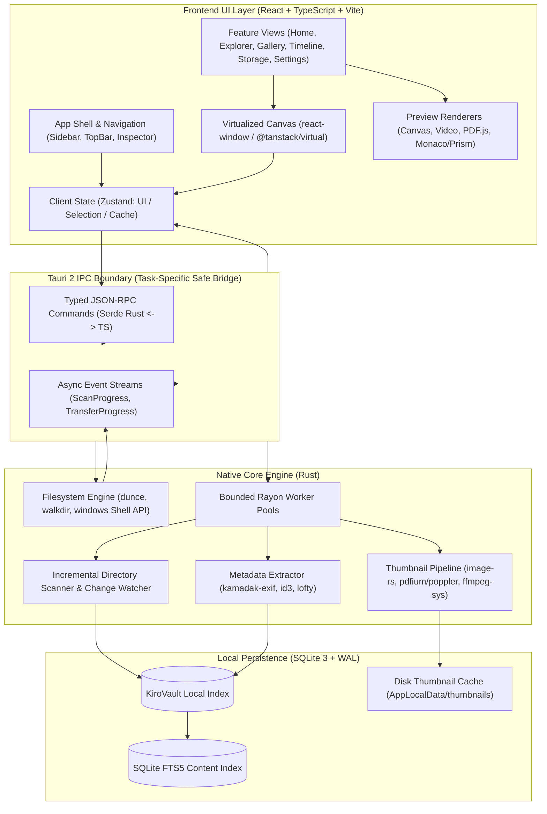
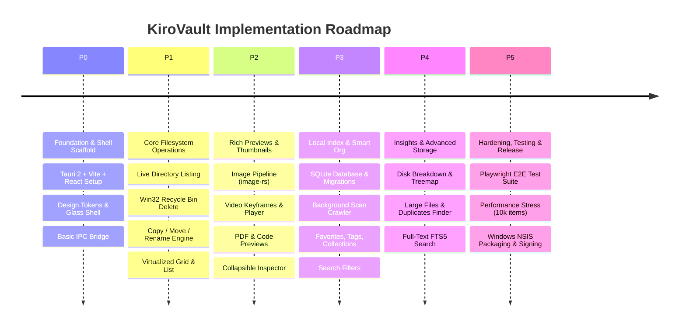

# KiroVault — Master Implementation & Architecture Specification
**Windows-First, Local-First Visual Desktop File Manager**  
*Synthesized from Master Blueprint, Screen Schematics, Architecture Diagrams, and Companion Technical Specifications (v1.0)*

---

## 1. Executive Summary & Product Vision

**KiroVault** is a modern, high-performance visual desktop file manager for Windows (Windows 10/11 64-bit). It bridges the gap between Windows File Explorer's raw filesystem access and modern, media-rich library experiences (inspired by iOS/macOS Photos & Files, and Windows Fluent 2 Design).

### Core Pillars
1. **Windows-First & Local-First**: Zero mandatory cloud accounts, zero unsolicited telemetry, zero remote dependencies. Everything runs locally on the user's workstation using SQLite, Rust, and native OS APIs.
2. **Real Filesystem Fidelity**: Operates on live NTFS, exFAT, and FAT32 drives (`C:\`, `D:\`, external drives, USB storage). Never locks files into a proprietary database container or silo. Virtual organization (tags, collections, favorites) layers on top of real filesystem paths without moving or altering original files.
3. **Controlled Glass & Clean Information Hierarchy**: Acrylic and mica-inspired translucent materials applied to navigation, chrome, and inspector sidebars, while maintaining calm, high-contrast content surfaces for readable filenames and thumbnails.
4. **Resilient & Safe Operations**: Real-time progress tracking, graceful cancellation, conflict handling (Skip / Replace / Keep Both / Cancel), Recycle Bin integration, and strict permission degradation states for offline or protected drives.
5. **High-Performance Demand-Driven Pipeline**: Virtualized grid and list views capable of smoothly handling 10,000+ files per directory, powered by an asynchronous Rust native engine, bounded thumbnail generator queues, and an SQLite WAL cache.

---

## 2. Source Document Matrix & Blueprint Artifacts

Every file and image present in the KiroVault specification directory has been analyzed and mapped directly to this implementation guide:

| File Name | Format | Role & Scope in Implementation |
| :--- | :--- | :--- |
| [`KiroVault_Desktop_App_Blueprint.pdf`](file:///d:/Projects/KiroVault/KiroVault_Desktop_App_Blueprint.pdf) | PDF (26 pages) | **Master Product & Engineering Specification**: End-to-end feature catalogue, design guidelines, IPC contracts, screen flows, performance metrics, and release gates. |
| [`02_UI_UX_layout_schematics.png`](file:///d:/Projects/KiroVault/02_UI_UX_layout_schematics.png) | PNG (Visual) | **Screen Layout Schematics**: Visual layout breakdown of the three-zone Explorer, Top Chrome, Left Sidebar, Main Canvas, and Right Inspector. |
| [`02_UI_UX_Design_System.pdf`](file:///d:/Projects/KiroVault/02_UI_UX_Design_System.pdf) | PDF (Companion) | **Design System & Tokens**: Category color palettes, glass acrylic rules, typography hierarchy, responsive breakpoints, high-contrast & reduced motion rules. |
| [`03_Architecture_Diagram.png`](file:///d:/Projects/KiroVault/03_Architecture_Diagram.png) | PNG (Visual) | **System Architecture Schematic**: Component relationships across React Frontend, Tauri IPC Boundary, Rust Backend Engine, SQLite WAL DB, and Worker Threads. |
| [`03_Technical_Architecture.pdf`](file:///d:/Projects/KiroVault/03_Technical_Architecture.pdf) | PDF (Companion) | **Full Technical Stack Architecture**: IPC command boundaries, error reporting structures, concurrency model, and storage subsystem. |
| [`04_Frontend_Development_Guide.pdf`](file:///d:/Projects/KiroVault/04_Frontend_Development_Guide.pdf) | PDF (Companion) | **Frontend Engineering Guide**: React 18/19, TypeScript, Vite, Tailwind CSS, Zustand/TanStack Query, UI components, virtualization, and accessibility (WAI-ARIA). |
| [`05_Rust_Backend_Filesystem_Engine.pdf`](file:///d:/Projects/KiroVault/05_Rust_Backend_Filesystem_Engine.pdf) | PDF (Companion) | **Native Filesystem Engine**: Safe path traversal, canonical paths, junction/symlink loops, Win32 Shell Recycle Bin API, batch worker pipelines. |
| [`06_SQLite_Database_Schema_Search.pdf`](file:///d:/Projects/KiroVault/06_SQLite_Database_Schema_Search.pdf) | PDF (Companion) | **Database & Search Engine**: SQLite schema (`files`, `metadata`, `thumbnails`, `tags`), WAL mode, indexes, FTS5 full-text search, incremental scan checkpoints. |
| [`07_Preview_Thumbnail_Engine.pdf`](file:///d:/Projects/KiroVault/07_Preview_Thumbnail_Engine.pdf) | PDF (Companion) | **Thumbnail & Preview Pipeline**: Format support matrix (Raster, RAW, Vector, Video, Audio, PDF, Code), caching, downsampling, and process isolation. |
| [`08_Security_Privacy_Permissions.pdf`](file:///d:/Projects/KiroVault/08_Security_Privacy_Permissions.pdf) | PDF (Companion) | **Security, Privacy & Sandboxing**: Restrictive Tauri capabilities, read-only preview fallbacks, Win32 permission handling, path traversal prevention (`..`), sanitization. |
| [`09_Testing_Quality_Assurance.pdf`](file:///d:/Projects/KiroVault/09_Testing_Quality_Assurance.pdf) | PDF (Companion) | **QA & Verification Suite**: Unit tests (Vitest + `cargo test`), integration tests, Playwright E2E automation, stress benchmarks (10k items, disconnected drives). |
| [`10_Build_Installer_Release_Guide.pdf`](file:///d:/Projects/KiroVault/10_Build_Installer_Release_Guide.pdf) | PDF (Companion) | **Packaging & Distribution**: Windows NSIS / MSI installer builds, WebView2 bootstrapper, code signing requirements, CI/CD GitHub Actions workflow. |
| [`11_API_Contracts_Implementation_Tasks.pdf`](file:///d:/Projects/KiroVault/11_API_Contracts_Implementation_Tasks.pdf) | PDF (Companion) | **IPC Command Contracts & Staged Tasks**: Rust-to-Frontend JSON-RPC API interfaces, error payload specs, and P0 through P5 implementation backlog. |

---

## 3. System Architecture & Component Model

The system follows a layered, isolated, local-first architecture as specified in `03_Architecture_Diagram.png` and `03_Technical_Architecture.pdf`.



---

## 4. UI/UX Design System & Layout Specifications

As specified in `02_UI_UX_layout_schematics.png` and `02_UI_UX_Design_System.pdf`:

### 4.1. Three-Zone Workspace Layout
1. **Zone 1: Persistent Left Sidebar (240px - 280px)**
   - *Quick Access*: Home, Recent, Favorites, Trash/Recycle Bin.
   - *Smart Categories*: Photos, Videos, Documents, Audio, Archives, Code.
   - *Drives & Storage*: Local physical drives (`C:`, `D:`), mounted USB/removable drives with live capacity bars, pinned user folders (`Downloads`, `Desktop`, `Documents`).
2. **Zone 2: Main Content Area (Flexible, Virtualized)**
   - *Top Navigation Chrome*: Back / Forward / Up navigation history buttons, interactive Breadcrumb Trail, Path Address Bar (editable on click + copy button), Search Input with scope toggle (`Current Folder` vs `All PC`), View Mode Switcher (Grid, Large Gallery, Detailed List, Date Timeline), Sorting dropdown (Name, Date Modified, Size, Kind, Asc/Desc).
   - *Content Canvas*: Responsive virtualized grid or table with multi-select marquee, drag-and-drop support, context menu triggers, and empty/loading skeleton states.
3. **Zone 3: Collapsible Inspector / Details Panel (Right, 320px - 400px)**
   - *Visual Preview*: Large dynamic preview thumbnail or embedded player.
   - *Metadata Block*: Filename, full canonical path, size, MIME kind, created/modified timestamps, permissions.
   - *Media Specifics*: Resolution, color space, EXIF camera model, shutter/ISO, video duration, codec, bitrate, audio tags (Artist, Album, Sample Rate).
   - *Interactive Actions*: "Open With", "Reveal in Explorer", "Copy Path", "Add Tag", "Pin to Favorites".

### 4.2. Pastel Category Color Palette
Files are visually distinguished using low-saturation pastel badges and iconography:

| Category | File Extensions | Hex Token | Visual Role |
| :--- | :--- | :--- | :--- |
| **Photos** | `.jpg`, `.jpeg`, `.png`, `.webp`, `.gif`, `.heic`, `.raw`, `.cr2`, `.nef`, `.avif` | `#E1EBFF` | Ice Blue |
| **Videos** | `.mp4`, `.mkv`, `.mov`, `.avi`, `.webm`, `.wmv` | `#F9E2D2` | Peach |
| **Documents** | `.pdf`, `.docx`, `.xlsx`, `.pptx`, `.txt`, `.md`, `.rtf`, `.csv` | `#E0F0DE` | Mint |
| **Code** | `.rs`, `.ts`, `.tsx`, `.js`, `.py`, `.json`, `.html`, `.css`, `.toml`, `.yaml`, `.c`, `.cpp` | `#EDE2FF` | Lavender |
| **Audio** | `.mp3`, `.flac`, `.wav`, `.aac`, `.ogg`, `.m4a` | `#F9E3EC` | Rose |
| **Archives** | `.zip`, `.rar`, `.7z`, `.tar`, `.gz`, `.bz2` | `#F4EED5` | Champagne |

### 4.3. Visual Materials & Theme Tokens
- **Glass / Acrylic Blur**: `backdrop-filter: blur(20px) saturate(180%)`; applied to Sidebar, Top Chrome, Context Menus, and Modal Overlays.
- **Surface Elevation**:
  - Light Mode: Background `#F9FAFB`, Surface `#FFFFFF`, Border `rgba(0, 0, 0, 0.08)`.
  - Dark Mode: Background `#121214`, Surface `#1A1A1E`, Border `rgba(255, 255, 255, 0.08)`.
- **Accessibility & Contrast**: Conforms to WCAG 2.1 AA (minimum 4.5:1 text contrast ratio). High-contrast mode toggles off acrylic transparencies to solid opaque backgrounds. Respects `prefers-reduced-motion`.

---

## 5. Technology Stack & Project Structure

### 5.1. Core Tech Stack
- **Desktop Runtime**: [Tauri v2](https://v2.tauri.app/) (Rust 1.78+ + Windows WebView2).
- **Frontend Framework**: React 18/19 + TypeScript 5.x.
- **Build Tool**: Vite 5.x.
- **Styling**: Tailwind CSS + custom CSS Glass tokens + Lucide React Icons.
- **State & Data Fetching**: Zustand (UI layout, selection, player state) + TanStack Query (cached directory listings, async index queries).
- **Virtualization**: `@tanstack/react-virtual` or `react-window` for infinite grid/table rendering.
- **Backend Core**: Rust (Tokio multi-threaded runtime, Rayon parallel iterators, `windows` crate for Shell APIs).
- **Database Subsystem**: `rusqlite` (with bundled SQLite 3.45+, WAL mode enabled) + FTS5 full-text module.

### 5.2. Standard Repository Blueprint
```text
KiroVault/
|-- .github/
|   `-- workflows/
|       |-- ci.yml                   # Linting, unit tests, cargo test
|       `-- release.yml              # Tauri build & NSIS release creation
|-- docs/
|   |-- architecture.md
|   |-- api-contracts.md
|   |-- preview-pipeline.md
|   `-- release-checklist.md
|-- public/
|   |-- brand/
|   `-- placeholders/
|-- src/                             # React + TypeScript Frontend
|   |-- app/
|   |   |-- App.tsx
|   |   |-- router.tsx
|   |   `-- providers/
|   |-- components/
|   |   |-- shell/                   # Sidebar, TopBar, Breadcrumbs, Inspector
|   |   |-- files/                   # FileGrid, FileList, FileCard, ContextMenu
|   |   |-- preview/                 # Image, Video, PDF, Text, Hex, Fallback
|   |   `-- ui/                      # Button, Dialog, Dropdown, Tooltip, Input
|   |-- features/
|   |   |-- home/                    # Recent files, quick drives, smart collections
|   |   |-- explorer/                # Live directory navigation & file operations
|   |   |-- gallery/                 # High-res media grid
|   |   |-- timeline/                # Chronological photo/video timeline
|   |   |-- search/                  # Global & folder search with filters
|   |   |-- storage/                 # Disk breakdown, largest files, duplicates
|   |   `-- settings/                # Appearance, indexing, cache management
|   |-- hooks/                       # useDirectory, useSelection, useShortcuts
|   |-- services/                    # Typed Tauri invoke() API wrappers
|   |-- styles/                      # Tailwind styles, glassmorphism, themes
|   |-- types/                       # Shared DTOs (FileItem, Metadata, IPC)
|   `-- utils/                       # Formatters, file size helpers, date utils
|-- src-tauri/                       # Native Rust Desktop Core
|   |-- Cargo.toml
|   |-- tauri.conf.json
|   |-- capabilities/
|   |   `-- default.json             # Fine-grained Tauri security permissions
|   `-- src/
|       |-- main.rs
|       |-- lib.rs
|       |-- commands/
|       |   |-- filesystem.rs        # List, stat, move, copy, delete, rename
|       |   |-- indexing.rs          # Background file crawler & change sync
|       |   |-- thumbnails.rs        # Thumbnail generation & disk caching
|       |   |-- metadata.rs          # EXIF, ID3, video stream parser
|       |   `-- search.rs            # SQLite & FTS5 queries
|       |-- db/
|       |   |-- mod.rs
|       |   |-- migrations.rs        # Schema versioning & updates
|       |   `-- queries.rs           # Prepared SQL statements
|       |-- models/
|       |   |-- file_entry.rs
|       |   |-- metadata.rs
|       |   `-- errors.rs            # Strongly-typed IPC error codes
|       `-- services/
|           |-- recycle_bin.rs       # Win32 IFileOperation / SHFileOperation
|           |-- thumbnail_worker.rs  # Rayon pipeline with memory bounds
|           `-- watcher.rs           # notify crate Windows ReadDirectoryChangesW
|-- tests/
|   |-- unit/                        # Frontend Vitest & Rust cargo test
|   |-- e2e/                         # Playwright desktop automation tests
|   `-- fixtures/                    # Test files (corrupted images, long paths)
|-- package.json
|-- tsconfig.json
`-- vite.config.ts
```

---

## 6. Rust Filesystem Engine & Win32 Integration

As detailed in `05_Rust_Backend_Filesystem_Engine.pdf` and `08_Security_Privacy_Permissions.pdf`:

### 6.1. Path Normalization & Canonicalization
- Every path received from the frontend is normalized using `dunce::canonicalize` to resolve extended path prefixes (`\\?\C:\...`), relative traversals (`..\..\`), and symlink/junction targets.
- Detects directory junction loops (e.g. Windows `AppData\Local\Application Data` recursion) using cycle-tracking sets during traversals.

### 6.2. Safe Operations & Win32 Recycle Bin Integration
- **Delete Policy**: Never invokes a hard unrecoverable delete by default. Deletions route through Windows Shell API (`SHFileOperationW` or `IFileOperation::DeleteItem`) with `FOF_ALLOWUNDO` flag enabled, sending files directly to the native Windows Recycle Bin.
- **Permanent Delete**: Supported only when explicitly requested by user confirmation flag (`mode: "Permanent"`).
- **Collision Strategies**: When moving or copying, the API supports:
  - `Replace`: Overwrites existing target.
  - `Skip`: Skips the colliding item and logs a warning.
  - `KeepBoth`: Automatically generates unique suffixed filename (e.g. `report (1).pdf`).
  - `Cancel`: Aborts subsequent operations in the batch.
- **Batch Transfer Architecture**: Long file transfers execute in background threads. They emit `TransferProgress` events (`bytes_copied`, `total_bytes`, `current_file`, `items_remaining`) across the Tauri IPC boundary to power an interactive UI progress drawer.

---

## 7. Local Database Schema & Search Engine

As specified in `06_SQLite_Database_Schema_Search.pdf`:

### 7.1. Database Engine Configurations
- **Database Engine**: Embedded SQLite 3 with `rusqlite`.
- **Storage Location**: `%LOCALAPPDATA%\KiroVault\index.db`.
- **Pragmas**:
  ```sql
  PRAGMA journal_mode = WAL;
  PRAGMA synchronous = NORMAL;
  PRAGMA foreign_keys = ON;
  PRAGMA temp_store = MEMORY;
  PRAGMA mmap_size = 268435456; -- 256MB memory-mapped I/O
  ```

### 7.2. Table Schemas
```sql
-- 1. Files & Directories Index
CREATE TABLE IF NOT EXISTS files (
    id INTEGER PRIMARY KEY AUTOINCREMENT,
    canonical_path TEXT NOT NULL UNIQUE,
    parent_path TEXT NOT NULL,
    filename TEXT NOT NULL,
    extension TEXT,
    kind TEXT NOT NULL,                -- 'photo', 'video', 'document', 'code', 'audio', 'archive', 'folder', 'other'
    size_bytes INTEGER NOT NULL,
    is_directory INTEGER NOT NULL DEFAULT 0,
    is_hidden INTEGER NOT NULL DEFAULT 0,
    is_system INTEGER NOT NULL DEFAULT 0,
    created_at INTEGER NOT NULL,       -- Unix timestamp (milliseconds)
    modified_at INTEGER NOT NULL,
    indexed_at INTEGER NOT NULL,
    source_root TEXT NOT NULL,         -- e.g. 'C:\', 'D:\'
    scan_status TEXT DEFAULT 'ready'   -- 'ready', 'pending_metadata', 'error'
);
CREATE INDEX IF NOT EXISTS idx_files_parent ON files(parent_path);
CREATE INDEX IF NOT EXISTS idx_files_modified ON files(modified_at DESC);
CREATE INDEX IF NOT EXISTS idx_files_kind ON files(kind);
CREATE INDEX IF NOT EXISTS idx_files_size ON files(size_bytes DESC);

-- 2. Rich Media Metadata
CREATE TABLE IF NOT EXISTS media_metadata (
    file_id INTEGER PRIMARY KEY,
    width INTEGER,
    height INTEGER,
    duration_ms INTEGER,
    codec TEXT,
    bitrate INTEGER,
    camera_make TEXT,
    camera_model TEXT,
    iso INTEGER,
    exposure_time TEXT,
    f_number REAL,
    audio_artist TEXT,
    audio_album TEXT,
    audio_title TEXT,
    audio_year INTEGER,
    metadata_source TEXT NOT NULL,     -- 'exif', 'ffmpeg', 'id3'
    FOREIGN KEY(file_id) REFERENCES files(id) ON DELETE CASCADE
);

-- 3. Thumbnail Cache Tracker
CREATE TABLE IF NOT EXISTS thumbnail_cache (
    cache_key TEXT PRIMARY KEY,        -- SHA256(canonical_path + modified_at + target_size)
    file_id INTEGER NOT NULL,
    target_size INTEGER NOT NULL,      -- 64, 128, 256, 512
    cached_file_path TEXT NOT NULL,
    generator_version INTEGER NOT NULL DEFAULT 1,
    created_at INTEGER NOT NULL,
    FOREIGN KEY(file_id) REFERENCES files(id) ON DELETE CASCADE
);
CREATE INDEX IF NOT EXISTS idx_thumb_file ON thumbnail_cache(file_id);

-- 4. Favorites & Pinned Locations
CREATE TABLE IF NOT EXISTS favorites (
    id INTEGER PRIMARY KEY AUTOINCREMENT,
    canonical_path TEXT NOT NULL UNIQUE,
    item_kind TEXT NOT NULL,           -- 'file' or 'directory'
    pinned_at INTEGER NOT NULL
);

-- 5. User Tags (Color Coded)
CREATE TABLE IF NOT EXISTS tags (
    id INTEGER PRIMARY KEY AUTOINCREMENT,
    name TEXT NOT NULL UNIQUE,
    color_hex TEXT NOT NULL
);

CREATE TABLE IF NOT EXISTS file_tags (
    file_id INTEGER NOT NULL,
    tag_id INTEGER NOT NULL,
    created_at INTEGER NOT NULL,
    PRIMARY KEY (file_id, tag_id),
    FOREIGN KEY(file_id) REFERENCES files(id) ON DELETE CASCADE,
    FOREIGN KEY(tag_id) REFERENCES tags(id) ON DELETE CASCADE
);

-- 6. Smart Virtual Collections
CREATE TABLE IF NOT EXISTS collections (
    id INTEGER PRIMARY KEY AUTOINCREMENT,
    title TEXT NOT NULL,
    description TEXT,
    filter_rules_json TEXT NOT NULL,   -- Rules for auto-populating results
    created_at INTEGER NOT NULL
);

-- 7. Full-Text Search (FTS5) for Supported Documents/Code
CREATE VIRTUAL TABLE IF NOT EXISTS content_fts USING fts5(
    file_id UNINDEXED,
    filename,
    extracted_text,
    content='files',
    content_rowid='id',
    tokenize='porter unicode61'
);
```

---

## 8. Thumbnail & Rich Preview Engine

As detailed in `07_Preview_Thumbnail_Engine.pdf`:

### 8.1. Format Support Matrix & Adapters

| Media Category | Supported Formats | Engine / Library | Preview Delivery Strategy |
| :--- | :--- | :--- | :--- |
| **Raster Images** | JPEG, PNG, WebP, GIF, BMP, AVIF | `image-rs` in Rust worker | Downscaled WebP thumbnails (64px, 256px, 512px). Cached to disk. |
| **Camera RAW** | CR2, NEF, ARW, DNG | `rawloader` / LibRaw | Embedded JPEG preview extraction. |
| **Vector Graphics** | SVG | WebView2 native DOM renderer | Sandboxed `iframe` / sanitized inline SVG (scripts stripped). |
| **Video Files** | MP4, MKV, MOV, WebM, AVI | `ffmpeg` / hardware decoder | Keyframe thumbnail extraction at 10% duration. Video player in Inspector. |
| **Audio Files** | MP3, FLAC, WAV, AAC, OGG | `lofty` / `id3` | Album art extraction + HTML5 WebAudio waveform player. |
| **PDF Documents** | PDF | `pdfium` or `pdf.js` worker | First-page rasterization for thumbnail; multi-page canvas viewer. |
| **Text / Code** | TS, JS, RS, PY, JSON, MD, TXT | Custom streaming byte reader | First 256KB read in Rust; rendered via read-only syntax highlighter. |
| **Archives** | ZIP, 7Z, TAR | `zip` / `sevenz-rust` | File list tree view without extracting archive contents to disk. |

### 8.2. Pipeline Concurrency & Safety Controls
- **Queue Throttling**: Rayon thread pool bounded to `min(logical_cpus, 4)` to avoid saturating CPU/disk when navigating folders with thousands of media files.
- **Lazy Demand-Driven Generation**: UI requests thumbnails only for currently visible virtual viewport rows.
- **Cache Invalidation**: Cache keys incorporate the file's canonical path, size, and last modified timestamp (`mtime`). If the user modifies an image externally, the cache key changes and invalidates old thumbnails automatically.
- **Fail-Safe Fallbacks**: If a file is corrupted or unsupported, the engine returns a typed `Fallback { reason: "UnsupportedCodec" }` result and renders the standard pastel file category icon. It never crashes or leaves an empty blank panel.

---

## 9. API Contracts (IPC Command Specifications)

As documented in `11_API_Contracts_Implementation_Tasks.pdf`:

All native communication between the React frontend and Rust backend utilizes typed Tauri commands.

### 9.1. Error Envelope Standard
```typescript
export interface CommandResult<T> {
  success: boolean;
  data?: T;
  error?: {
    code: 'NotFound' | 'PermissionDenied' | 'Conflict' | 'DeviceOffline' | 'Cancelled' | 'PartialFailure' | 'InternalError';
    message: string;
    target_path?: string;
    details?: Record<string, unknown>;
  };
}
```

### 9.2. Core Tauri Command Definitions
```typescript
// 1. Filesystem Directory Browsing
export interface ListDirectoryArgs {
  path: string;
  sort_by: 'name' | 'modified_at' | 'size_bytes' | 'kind';
  sort_direction: 'asc' | 'desc';
  show_hidden: boolean;
  filter_kind?: string;
}

export interface DirectoryListing {
  current_path: string;
  parent_path: string | null;
  items: FileEntry[];
  total_files: number;
  total_folders: number;
  total_size_bytes: number;
  is_read_only: boolean;
}

// 2. Batch File Operations
export interface FileOperationItem {
  source_path: string;
  destination_path?: string;
}

export interface BatchOperationArgs {
  items: FileOperationItem[];
  conflict_policy: 'Skip' | 'Replace' | 'KeepBoth' | 'Cancel';
}

export interface BatchOperationResult {
  completed_count: number;
  failed_count: number;
  results: {
    path: string;
    status: 'Success' | 'Skipped' | 'Failed';
    error_message?: string;
  }[];
}

// 3. Delete Operation
export interface DeleteArgs {
  paths: string[];
  mode: 'RecycleBin' | 'Permanent';
}

// 4. Thumbnail & Preview Requests
export interface GetThumbnailArgs {
  path: string;
  target_size: 64 | 128 | 256 | 512;
}

export interface ThumbnailResponse {
  cache_hit: boolean;
  thumbnail_url: string; // asset:// protocol or local cached file path
  width: number;
  height: number;
}

// 5. Native Shell Integrations
// fs_open_path(path: string) -> Opens with default Windows application
// fs_reveal_in_explorer(path: string) -> Launches explorer.exe /select,path
// fs_copy_to_clipboard(paths: string[]) -> Writes paths to Windows clipboard
```

---

## 10. Security, Privacy & Permission Guardrails

As specified in `08_Security_Privacy_Permissions.pdf`:

1. **Local-First & Sandboxed IPC**:
   - Webview is restricted from making external network requests (`Content-Security-Policy: default-src 'self' asset:; img-src 'self' asset: data:; media-src 'self' asset:; style-src 'self' 'unsafe-inline'`).
   - No arbitrary shell script execution. Only strict, pre-approved native Rust commands are registered in `tauri.conf.json`.
2. **Access Control & Offline Storage**:
   - Graceful degradation when dealing with protected Windows folders (e.g. `System Volume Information`, `Windows\System32`) or disconnected external drives (`E:\`). Displays an inline badge: *"Permission Denied — Access is restricted by Windows security"* while keeping back/forward navigation functional.
3. **Execution Prevention**:
   - Preview engine strictly treats files as passive data. Executable files (`.exe`, `.bat`, `.cmd`, `.ps1`, `.msi`) are NEVER executed or evaluated in previews; only static icon and PE header metadata (version, architecture) are extracted.
4. **Zero Path Leakage in Error Logs**:
   - Diagnostics and error telemetry never expose user usernames or sensitive system file paths in customer-facing dialogs.

---

## 11. Staged Implementation Roadmap (P0 - P5)

Derived from `11_API_Contracts_Implementation_Tasks.pdf` and Blueprint Section 16:



### Phase Details

#### Phase P0: Foundation & Core Scaffold
- Scaffold Vite + React 18/19 + TypeScript + Tauri 2 template in workspace.
- Establish Tailwind CSS configuration with pastel tokens and glassmorphism blur classes.
- Implement responsive shell: Left Sidebar, Top Navigation Bar, Main Canvas, Right Inspector.
- Implement typed Tauri IPC wrapper with error boundaries.

#### Phase P1: Core Browsing & Safe Filesystem Engine
- Implement `list_directory`, `get_drives`, `stat_path` commands in Rust using `dunce` and `std::fs`.
- Implement virtualized grid and table views using `@tanstack/react-virtual` with smooth scroll.
- Add path navigation: Breadcrumb bar, back/forward history stack, and editable path input.
- Implement safe file operations: Win32 Recycle Bin deletion (`IFileOperation`), conflict-aware copy/move, and inline renaming.

#### Phase P2: Thumbnail Pipeline & Rich Previews
- Setup Rayon background worker queue for image downscaling and WebP disk caching.
- Build format-specific preview components:
  - Images: Pan/zoom viewer with EXIF metadata inspector.
  - Video: Keyframe extraction + native video playback in inspector.
  - PDF: Canvas page renderer using PDF.js.
  - Code/Text: Monaco or Prism read-only viewer with line numbers.
- Implement fallback card for unsupported binary formats.

#### Phase P3: SQLite Database, Indexing & Smart Organization
- Initialize SQLite database with WAL mode and run migrations (`files`, `media_metadata`, `tags`).
- Implement background crawler in Rust to index user folders incrementally.
- Add user-facing Favorites (pinning drives and folders) and multi-color Tags.
- Build "Recent Files" and "Smart Collections" (e.g. "Screenshots", "Large Downloads").

#### Phase P4: Storage Insights & Search
- Implement Drive Storage Analyzer: Disk capacity visualization, folder size aggregation, and largest files list.
- Build Duplicate Candidate Finder (matching candidate files by size + quick SHA256 header hash).
- Implement global and folder search with instant filtering by extension, category, size, and date range.
- Implement optional FTS5 document indexing for local text search.

#### Phase P5: Hardening, Performance Testing & Release
- Conduct stress tests: 10,000+ items per directory listing, unplugged drives, Unicode filenames, read-only permissions.
- Validate memory consumption (< 150MB baseline idle) and cold startup time (< 1.2s on SSD).
- Verify dark/light theme contrast and accessibility keyboard navigation (WAI-ARIA).
- Configure Tauri NSIS / MSI installer bundling, application icons, and release metadata.

---

## 12. Quality Assurance, Test Strategy & Verification

As detailed in `09_Testing_Quality_Assurance.pdf`:

### 12.1. Testing Matrix

| Level | Tool / Framework | Target Coverage | Scope & Scenarios |
| :--- | :--- | :--- | :--- |
| **Rust Unit Tests** | `cargo test` | Filesystem & DB logic | Path normalization, symlink cycle detection, SQLite migrations, conflict filename resolver. |
| **Frontend Unit** | Vitest + React Testing Library | UI components & stores | Format helpers, Zustand state transitions, selection logic (Ctrl/Shift clicks), breadcrumbs. |
| **Integration Tests** | Rust integration harness | IPC Command Boundary | Batch copy/move with conflicting files, partial failure reporting, thumbnail caching. |
| **E2E Automation** | Playwright Desktop / WebDriver | Full user flows | Drive navigation, renaming files, toggling views, searching, inspecting media, settings toggles. |
| **Stress & Edge Cases** | Custom synthetic test runner | Reliability & Limits | Folder with 10,000 files; long Windows paths (> 260 chars); unplugged USB drive; read-only files. |

### 12.2. Acceptance Targets & Definition of Done
- **Cold App Launch**: < 1.2 seconds to interactive shell.
- **Directory Render**: 1,000 files listed and rendered in virtualized grid within < 200ms.
- **Scroll Performance**: Stable 60 FPS while scrolling virtualized grid with thumbnails loading asynchronously.
- **File Integrity**: Zero file corruption; original filesystem structure untouched.
- **Error Handling**: Graceful error alert on disconnected drives; clear message on permission denial without app crash.
- **Clean Lifecycle**: Installer creates clean desktop/start menu shortcuts; uninstaller completely removes app binaries without touching user personal files.

---

## 13. Getting Started & Windows Developer Setup

As specified in `10_Build_Installer_Release_Guide.pdf` and Blueprint Section 18:

### 13.1. Prerequisites
1. **OS**: Windows 10/11 64-bit.
2. **Node.js**: v20+ LTS and `npm`.
3. **Rust**: Rustup stable toolchain (`x86_64-pc-windows-msvc`).
4. **C++ Build Tools**: Visual Studio 2022 C++ Build Tools (with Windows 10/11 SDK).
5. **WebView2**: Windows 10/11 default runtime (or Evergreen Standalone bootstrapper).

### 13.2. Scaffolding & Initial Startup
```powershell
# 1. Initialize Vite React + TypeScript Frontend
npm create vite@latest . -- --template react-ts

# 2. Install Frontend Dependencies
npm install
npm install -D tailwindcss postcss autoprefixer
npx tailwindcss init -p
npm install lucide-react zustand @tanstack/react-query @tanstack/react-virtual

# 3. Add Tauri 2 CLI & Core
npm install -D @tauri-apps/cli@latest
npm install @tauri-apps/api@latest
npx tauri init

# 4. Start Development Mode (Launches Desktop Window with Hot Reload)
npx tauri dev

# 5. Build Production Windows Installer (.exe / .msi)
npx tauri build
```

---

*This document serves as the single source of truth for the design, architecture, and coding execution of KiroVault.*
